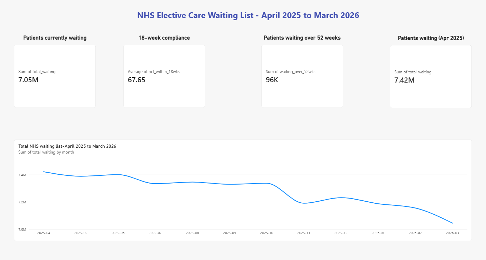
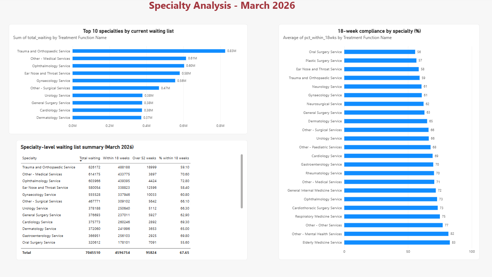
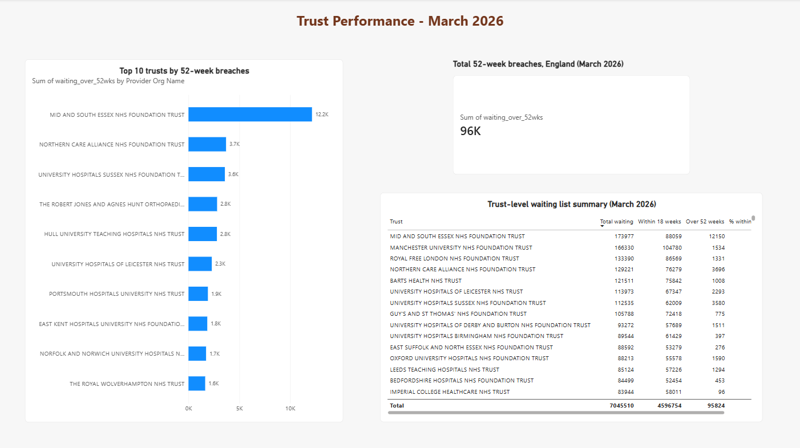

# NHS RTT Waiting List Analysis

I built this project to look at how the NHS waiting list changed over 12 months, from April 2025 to March 2026\.

## Why I built it

I spent a year working in Radiology at Epsom and St Helier NHS Trust. I used to check RTT pathways every day for patients I was booking. This project takes that same idea and looks at it at a national scale across all NHS trusts and specialties.

## What I found

- The waiting list dropped from 7.42 million to 7.05 million.  
- 18-week compliance went up from 59.7% to 65.2%.  
- Patients waiting over 52 weeks halved, from 192,560 to 95,824.  
- Oral Surgery and Plastic Surgery had the worst compliance.  
- Trauma and Orthopaedics had the biggest waiting list.  
- Mid and South Essex NHS Foundation Trust had the most 52-week breaches.

My numbers match what NHS England publishes each month.

## Tools I used

- Python (for cleaning the data)  
- SQL (for the analysis)  
- Power BI (for the dashboard)

## Data source

NHS England publishes RTT data every month. I downloaded 12 months of it from their website.

## About me

I'm Keerthana Krishna. I have an MSc in Data Science and Analytics from Cardiff University and a year of NHS experience. I'm looking for data analyst roles in the UK.
## The dashboard

### Executive summary

### Specialty analysis

### Trust performance

